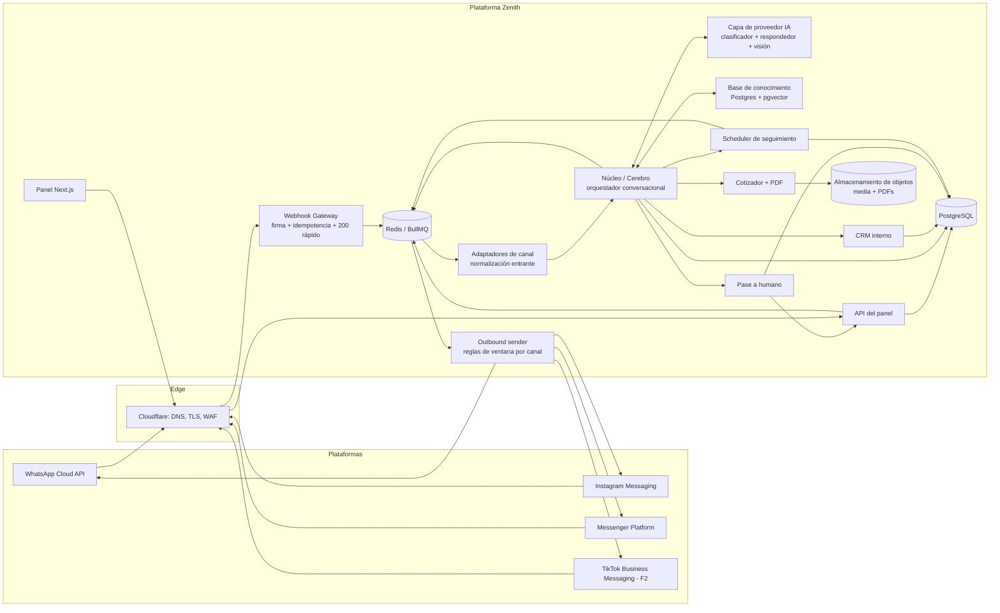

# Especificación técnica: Zenith Bot omnicanal con IA (multi-tenant)

> Versión 0.1 · Borrador de arquitectura · Equipo GrupoZenith
> Convenciones: `[DECIDIR]` = lo debe confirmar el cliente o el equipo · "por verificar" = restricción de plataforma no confirmada en documentación oficial · "sin dato" = cifra que depende de volumen o de información que no tenemos.
> Nombre del producto: provisional `[DECIDIR]`.

---

## 1. Objetivo, usuarios y alcance

**Objetivo.** Una plataforma reutilizable donde cada negocio cliente de GrupoZenith (tenant) conecta sus canales de mensajería y obtiene un bot que responde a sus clientes finales con datos reales del negocio (catálogo, precios, políticas), identifica piezas por foto y cotiza en PDF, hace seguimiento, deriva a una persona cuando hace falta y registra todo como contacto u oportunidad.

**Actores**

| Actor | Qué hace |
|---|---|
| Cliente final (ej. comprador de la ferretería) | Escribe por WhatsApp, Instagram DM o Messenger (TikTok en fase 2). Pregunta, manda fotos, pide cotización. Nunca usa el panel. |
| Agente del negocio (vendedor) | Toma conversaciones derivadas en el panel web, responde manualmente, cierra oportunidades. |
| Administrador del negocio | Carga catálogo y políticas, configura reglas de derivación, plantillas, palabras clave, horarios y usuarios del panel. |
| Operador GrupoZenith (superadmin) | Da de alta tenants, conecta canales, monitorea, da soporte. Su acceso a conversaciones queda auditado. |
| Plataformas (Meta, TikTok) | Envían webhooks y reciben envíos con sus propias reglas. |

**Incluido**
- Núcleo con las 6 piezas: IA conversacional, base de conocimiento (RAG), visión con cotización en PDF, seguimiento, pase a humano con panel y CRM básico interno.
- Conectores: WhatsApp Cloud API (F1); Instagram y Messenger (F1b); TikTok (F2, sujeto a acceso).
- Automatización por comentario con palabra clave que dispara un DM (F1b en IG/FB, F2 en TikTok si la API lo permite).
- Panel web multi-tenant (Next.js) con roles.
- Infraestructura, monitoreo y respaldos.

**No incluido (salvo que se acuerde aparte)**
- Pagos o checkout dentro del chat. `[DECIDIR]` si se quiere en una fase posterior.
- Integración en tiempo real con ERP/inventario del cliente (stock en vivo). En F1 el stock es el que se carga en el catálogo. `[DECIDIR]`
- Integración con un CRM externo (HubSpot, Odoo, etc.). F1 usa el CRM interno. `[DECIDIR]`
- Canales no oficiales (WhatsApp Web por QR, scraping de TikTok, etc.). Quedan descartados por riesgo de bloqueo.
- Envíos masivos de marketing (campañas). Solo hay seguimientos 1 a 1. `[DECIDIR]`
- Voz o notas de audio: transcripción `[DECIDIR]`; por defecto el bot responde "por ahora solo leo texto e imágenes" y ofrece una persona.
- Apps móviles para los agentes (el panel es web responsive).

---

## 2. Arquitectura

### 2.1 Vista general



### 2.2 Procesos desplegables

| Proceso | Tipo | Responsabilidad |
|---|---|---|
| `gateway` | HTTP | Recibe webhooks, verifica firma, guarda el evento crudo, encola y responde 200. No ejecuta lógica de negocio. |
| `worker-inbound` | Worker BullMQ | Normaliza, resuelve tenant/contacto/conversación, ejecuta el cerebro. |
| `worker-outbound` | Worker BullMQ | Envía mensajes por canal respetando ventana, límites y reintentos. |
| `worker-jobs` | Worker BullMQ | Seguimientos programados, ingesta de base de conocimiento (embeddings), generación de PDFs, expiración de ventanas. |
| `api` | HTTP + WebSocket/SSE | Backend del panel: auth, CRUD, tiempo real para agentes. |
| `panel` | Next.js | UI de agentes y administradores. |

Todos los procesos son un monorepo TypeScript (Node.js LTS) con paquetes compartidos (`core`, `channels/*`, `ai`, `db`). Se despliegan como imágenes Docker de un mismo build con distinto comando de arranque.

---

## 3. Módulos y responsabilidades

| Módulo | Responsabilidad | No hace |
|---|---|---|
| **Webhook Gateway** | Handshake de verificación, validación de firma, deduplicación por ID externo, persistencia del evento crudo y encolado. | No llama a la IA ni a la BD de negocio más allá del evento crudo. |
| **Adaptadores de canal** (`channels/whatsapp`, `instagram`, `messenger`, `tiktok`) | Traducen el payload de cada plataforma a un `NormalizedEvent` y un `OutboundMessage` al formato de envío. Conocen las reglas de ventana, tipos de mensaje soportados, descarga de media y límites de cada canal. | No deciden qué responder. |
| **Cerebro (orquestador)** | Por cada evento: carga contexto, clasifica intención, decide la ruta (responder, visión, cotizar, derivar, silenciar porque hay un humano asignado), invoca herramientas y produce la respuesta. | No envía directamente; encola en outbound. |
| **Capa de proveedor IA** (`ai`) | Interfaz única `classify`, `respond`, `vision`, `embed`, con adaptadores por proveedor, timeouts, reintentos, registro de uso y costo por tenant. | No contiene prompts de negocio de un tenant concreto (eso vive en configuración). |
| **Base de conocimiento** | Ingesta de catálogo (CSV/Excel/API), políticas (texto/PDF), chunking, embeddings y búsqueda híbrida (vector + texto + filtros por SKU/categoría). | No inventa precios: el precio siempre sale de `products`/`price_lists`, no del texto recuperado. |
| **Visión y cotizador** | Descarga la imagen, extrae atributos con el modelo de visión, busca candidatos en el catálogo, pide confirmación al cliente, arma la cotización con precios de BD y genera el PDF. | No cotiza productos que no estén en el catálogo. |
| **Seguimiento** | Programa recordatorios cuando la conversación queda abierta ("lo pienso"), aplica la regla de ventana (texto libre dentro de 24 h; plantilla aprobada en WhatsApp fuera de ella; en IG/Messenger fuera de 24 h no hay seguimiento automático). Respeta opt-out. | No hace campañas masivas. |
| **Pase a humano** | Evalúa reglas (monto, cantidad, palabras clave, sentimiento, petición explícita, baja confianza), asigna la conversación, silencia al bot, notifica al equipo y gestiona la devolución al bot. | No responde por el agente. |
| **CRM interno** | Contactos, identidades por canal, oportunidades con etapas, notas, etiquetas, historial. Exportación a CSV/Excel. | No sincroniza con CRMs externos en F1. |
| **Comment-to-DM** | Recibe eventos de comentarios, compara con palabras clave por publicación o globales, envía el DM inicial permitido por la plataforma y abre la conversación. | No responde comentarios públicos con IA libre `[DECIDIR]`. |
| **Panel** | Bandeja de conversaciones, toma o devolución, respuesta manual, CRM, catálogo y KB, reglas, plantillas, usuarios, métricas básicas. | |
| **Tenancy y seguridad** | Alta de tenants, aislamiento (RLS), cifrado de credenciales, roles y auditoría. | |

### 3.1 Contrato de adaptador de canal

```ts
type Channel = 'whatsapp' | 'instagram' | 'messenger' | 'tiktok';

interface NormalizedEvent {
  tenantId: string;
  channelAccountId: string;
  channel: Channel;
  externalEventId: string;        // id único del mensaje/evento en la plataforma
  kind: 'message' | 'status' | 'comment' | 'postback' | 'reaction' | 'unsupported';
  from: { externalUserId: string; displayName?: string; phone?: string };
  occurredAt: Date;
  text?: string;
  media?: { type: 'image' | 'audio' | 'video' | 'document'; externalMediaId: string; mimeType?: string }[];
  comment?: { postId: string; commentId: string; text: string };
  status?: { externalMessageId: string; state: 'sent' | 'delivered' | 'read' | 'failed'; errorCode?: string };
  raw: unknown;                   // referencia al evento crudo (no se manda al LLM)
}

interface ChannelAdapter {
  verifySignature(req: RawRequest, secret: string): boolean;
  parse(body: unknown): NormalizedEvent[];
  windowState(conv: ConversationWindow, now: Date): WindowDecision; // ver sección 7
  send(msg: OutboundMessage, creds: ChannelCredentials): Promise<SendResult>;
  downloadMedia(externalMediaId: string, creds: ChannelCredentials): Promise<Buffer>;
  capabilities: { templates: boolean; humanAgentTag: boolean; commentToDm: boolean; maxTextLength?: number };
}
```

---

## 4. Flujo de un mensaje de punta a punta

Ejemplo: "¿tienen taladros percutores?" por WhatsApp.

1. **Recepción.** Meta hace POST a `/webhooks/meta/whatsapp`. El gateway valida la firma con el secreto de la app; si falla responde 401 y registra el evento.
2. **Idempotencia.** Inserta en `webhook_events` con clave única `(channel, external_event_id)`. Si ya existe, responde 200 y descarta. Así se absorben los reintentos de la plataforma.
3. **ACK rápido.** Encola `inbound:{tenant}` y responde 200 (objetivo interno: < 1 s; el límite exacto de cada plataforma está por verificar).
4. **Resolución de tenant.** Con el `phone_number_id` (WhatsApp) o el `page_id`/`ig_user_id` se resuelve `channel_account` y, a partir de ahí, `tenant`. Si no existe, el evento va a la DLQ con alerta.
5. **Normalización.** El adaptador produce `NormalizedEvent`. Los eventos `status` actualizan `outbound_messages` y terminan aquí.
6. **Contacto y conversación.** Upsert de `contact_identity` y `contact`; se obtiene la conversación abierta o se crea una. Se actualiza `last_inbound_at` y, con eso, la ventana de 24 h.
7. **Orden y ráfagas.** Lock por conversación en Redis para procesar en orden. *Debounce* (`[DECIDIR]`, sugerido 3 a 5 s) para agrupar mensajes seguidos del mismo cliente en un solo turno.
8. **¿Hay humano asignado?** Si `conversation.mode = 'human'`, no responde el bot: solo notifica al agente en el panel por tiempo real y termina.
9. **Clasificación** (modelo económico). Salida JSON validada con esquema (zod): `intent` (consulta_producto, precio, foto_pieza, cotizacion, politica, saludo, queja, pedir_humano, fuera_de_alcance), `entities` (producto, cantidad, marca), `handoff_signals`, `injection_suspected`, `language`.
10. **Reglas de derivación** (deterministas, antes de la IA generativa). Ejemplo: cantidad ≥ umbral del tenant, monto estimado ≥ umbral, pide humano, queja o baja confianza repetida. Si aplica, se pasa al paso 13.
11. **Recuperación (RAG).** Búsqueda híbrida en `kb_chunks` y `products` del tenant (filtrada por `tenant_id`): top-k fragmentos de políticas y productos candidatos con precio y stock leídos de la tabla, no del texto.
12. **Respuesta** (modelo capaz) con *tool use* restringido: `buscar_producto`, `obtener_precio`, `crear_cotizacion`, `derivar_a_humano`, `programar_seguimiento`. Validador de salida: si menciona un precio o SKU que no vino de una herramienta, se rechaza y se regenera o se usa una respuesta segura.
13. **Derivación** (si aplica). Mensaje configurado al cliente ("Te paso con un asesor…"), `mode='human'`, se crea un `handoff`, se notifica al equipo (panel y opcionalmente correo `[DECIDIR]`) y se actualiza la oportunidad.
14. **CRM.** Se actualiza la oportunidad (etapa, productos de interés, monto estimado) y el historial.
15. **Seguimiento.** Si la intención es "lo pienso" o la conversación queda abierta sin cierre, se programa un `follow_up` (sección 7).
16. **Envío.** Se encola `outbound` con clave de idempotencia. El worker consulta `windowState`: dentro de ventana envía texto libre; fuera de ella envía plantilla (WhatsApp) o bloquea y avisa (IG/Messenger). Guarda `external_message_id` y espera los `status`.
17. **Trazabilidad.** `ai_runs` registra modelo, tokens, latencia, costo estimado y `trace_id` del ciclo completo.

**Flujo de visión.** Llega una imagen, se descarga en el momento (las URLs de media requieren token y pueden expirar; duración por verificar) y se guarda en el almacenamiento de objetos con prefijo de tenant. El modelo de visión extrae atributos (tipo de pieza, medidas visibles, marca, rosca, material) en JSON validado. Con eso se buscan candidatos en el catálogo por atributos y texto (y por similitud de imagen si se carga foto de productos `[DECIDIR]`). Con confianza alta se proponen 1 a 3 opciones y el cliente confirma; con confianza baja se piden datos o se deriva. Con producto y cantidad confirmados se crea `quote` con precios de BD, se genera el PDF y se envía como documento. Validez, impuestos y moneda salen de la configuración del tenant `[DECIDIR]`.

---

## 5. Modelo de IA

**Capa de abstracción.** Interfaz `AiProvider` con `classify`, `respond`, `vision` y `embed`; un adaptador por proveedor, con modelo configurable por tenant y por tarea. Permite cambiar de proveedor o de modelo sin tocar el cerebro y hacer A/B con evals.

**Propuesta con Claude**

| Tarea | Modelo | Por qué |
|---|---|---|
| Clasificación de intención, extracción de entidades, detección de inyección, resumen para el agente al derivar | `claude-haiku-5-5` | Se ejecuta en cada mensaje; tarea acotada con salida estructurada. Es lo que más pesa en volumen: modelo más económico y de menor latencia. |
| Respuesta al cliente con RAG y herramientas, visión de piezas | `claude-sonnet-5-5` | Debe seguir instrucciones, usar herramientas sin inventar y entender fotos con detalle técnico. Equilibrio entre capacidad y costo. |
| Opcional: casos marcados como difíciles, generación de evals y revisión offline de calidad | `claude-opus-5-5` | Fuera del camino caliente por costo y latencia. Se activa solo por regla `[DECIDIR]`. |

**Embeddings.** No se asume que el proveedor del LLM ofrezca embeddings. Proveedor de embeddings `[DECIDIR]`. Su dimensión fija la columna `vector(n)`; cambiar de modelo implica reindexar.

**Costos de IA:** sin dato (dependen de mensajes por día, largo de contexto y proporción de imágenes). Se miden por tenant desde el día 1 en `ai_runs`.

---

## 6. Modelo de datos

PostgreSQL con **una base compartida y `tenant_id` en todas las tablas de negocio**, más Row Level Security (RLS): cada conexión fija `app.tenant_id` y las políticas filtran por él. Superadmin usa un rol aparte con acceso auditado. Identificadores UUID v7. Timestamps `timestamptz`.

| Tabla | Campos clave | Relaciones / notas |
|---|---|---|
| `tenants` | id, name, slug, status, timezone, currency, locale, settings (jsonb: umbrales, horarios, tono, mensajes fijos), created_at | Raíz del aislamiento. |
| `users` | id, email, name, password_hash o idp_id, mfa_enabled, status | Usuarios del panel. |
| `memberships` | user_id, tenant_id, role (`owner`, `admin`, `agent`, `viewer`) | Un usuario puede estar en varios tenants. |
| `channel_accounts` | id, tenant_id, channel, external_account_id (phone_number_id / page_id / ig_user_id / tiktok id), display_name, credentials_enc (bytea), credentials_key_id, status, webhook_secret_ref, connected_at | Tokens cifrados (sección 9). Único por `(channel, external_account_id)`. |
| `webhook_events` | id, channel, external_event_id, channel_account_id, payload (jsonb), signature_ok, received_at, processed_at, status, error | Único `(channel, external_event_id)`. Retención corta `[DECIDIR]`. |
| `contacts` | id, tenant_id, name, phone, email, tags[], opt_out_followups, notes, merged_into_id | |
| `contact_identities` | id, tenant_id, contact_id, channel, external_user_id, profile (jsonb) | Único `(tenant_id, channel, external_user_id)`. Fusión entre canales manual en F1. |
| `conversations` | id, tenant_id, contact_id, channel_account_id, status (`open`, `pending`, `closed`), mode (`bot`, `human`), assigned_user_id, last_inbound_at, last_outbound_at, window_expires_at, human_agent_until, summary | Ventana calculada desde `last_inbound_at`. |
| `messages` | id, tenant_id, conversation_id, direction (`in`, `out`), author (`customer`, `bot`, `agent`, `system`), type (`text`, `image`, `document`, `template`, ...), body, attachments (jsonb), external_message_id, ai_run_id, created_at | Índice `(conversation_id, created_at)`. |
| `outbound_messages` | id, tenant_id, message_id, idempotency_key, channel, payload, status (`queued`, `sent`, `delivered`, `read`, `failed`, `blocked_window`), attempts, last_error, external_message_id | Único `idempotency_key`. |
| `media_assets` | id, tenant_id, message_id, storage_key, mime_type, size, sha256, source_external_id | Bucket organizado por prefijo de tenant. |
| `products` | id, tenant_id, sku, name, description, brand, category, attributes (jsonb), unit, price, currency, stock_qty, stock_updated_at, active, image_keys[] | Único `(tenant_id, sku)`. Fuente de verdad de precios. |
| `price_lists` (opcional) | id, tenant_id, name, rules (por volumen o tipo de cliente) | `[DECIDIR]` si hay precios por mayor. |
| `kb_sources` | id, tenant_id, type (`catalog`, `policy`, `faq`, `file`), name, status, version, uploaded_by | |
| `kb_chunks` | id, tenant_id, source_id, product_id (nullable), content, metadata (jsonb), embedding vector(n), tsv tsvector | Índice HNSW en `embedding` y GIN en `tsv`. Siempre filtrado por `tenant_id`. |
| `quotes` | id, tenant_id, number, contact_id, conversation_id, status (`draft`, `sent`, `accepted`, `expired`), subtotal, taxes, total, currency, valid_until, pdf_key, created_by (`bot` o user_id) | Numeración correlativa por tenant. |
| `quote_items` | id, quote_id, product_id, sku_snapshot, name_snapshot, qty, unit_price_snapshot, line_total | Copia del precio al momento de cotizar. |
| `opportunities` | id, tenant_id, contact_id, conversation_id, stage_id, estimated_amount, products_of_interest (jsonb), source_channel, owner_user_id, lost_reason, closed_at | |
| `pipeline_stages` | id, tenant_id, name, order, is_won, is_lost | Etapas configurables por tenant. |
| `handoff_rules` | id, tenant_id, type (`qty_gte`, `amount_gte`, `keyword`, `intent`, `low_confidence`, `out_of_hours`), params (jsonb), priority, active | |
| `handoffs` | id, tenant_id, conversation_id, reason, rule_id, requested_at, taken_by, taken_at, returned_to_bot_at, ai_summary | Mide el tiempo de toma. |
| `follow_ups` | id, tenant_id, conversation_id, scheduled_at, attempt_no, strategy (`free_text`, `template`), template_id, status (`scheduled`, `sent`, `skipped_window`, `cancelled`, `failed`), reason | Se cancela si el cliente responde. |
| `wa_templates` | id, tenant_id, channel_account_id, name, language, category, components (jsonb), meta_status, last_synced_at | Sincronizado con el estado de aprobación en Meta. |
| `comment_triggers` | id, tenant_id, channel_account_id, post_external_id (nullable = global), keywords[], match_mode, dm_message, active | |
| `comment_events` | id, tenant_id, trigger_id, comment_external_id, author_external_id, dm_status | Único por `comment_external_id`, para no mandar dos DMs. |
| `ai_runs` | id, tenant_id, conversation_id, task, provider, model, input_tokens, output_tokens, latency_ms, cost_estimate, outcome, trace_id | No guarda el prompt completo con PII en claro; retención `[DECIDIR]`. |
| `audit_log` | id, tenant_id, actor_type, actor_id, action, entity, entity_id, diff (jsonb), ip, created_at | Accesos de superadmin, cambios de credenciales, exportaciones. |

---

## 7. Reglas de ventana de mensajería por canal

| Canal | Dentro de 24 h desde el último mensaje del usuario | Fuera de 24 h | Seguimiento automático fuera de 24 h | Notas |
|---|---|---|---|---|
| WhatsApp (Cloud API) | Mensaje libre (bot o humano). | Solo plantillas aprobadas por Meta. | Sí, solo con plantilla aprobada. Meta cobra por mensaje de plantilla (tarifa sin dato). | Negocio verificado y número dedicado. |
| Instagram | Mensaje libre (bot o humano). | Etiqueta Human Agent: solo respuesta **manual** de una persona hasta 7 días. No automatizable. | **No.** | Cuenta profesional vinculada y App Review. Límites de tasa por verificar. |
| Messenger | Mensaje libre (bot o humano). | Human Agent: respuesta manual hasta 7 días. | **No.** | App Review. Otras etiquetas o excepciones: por verificar (no se usan en el diseño). |
| TikTok (F2) | Por verificar. | Por verificar. | Por verificar. | API en beta o acceso restringido. |

**Implementación (`windowState`)**
- `window_expires_at = last_inbound_at + 24h`.
- El adaptador devuelve `FREE`, `TEMPLATE_ONLY`, `HUMAN_AGENT_ONLY` (IG/Messenger, entre 24 h y 7 días, solo si el autor es `agent`) o `CLOSED`.
- Si el bot intenta enviar y el estado no es `FREE`, el mensaje se marca `blocked_window` (salvo plantilla en WhatsApp) y se alerta en el panel.
- El panel muestra al agente una cuenta regresiva de la ventana y, fuera de ella, solo ofrece plantillas (WhatsApp) o la etiqueta Human Agent (IG/Messenger).
- Margen de seguridad: el bot no programa mensajes libres en los últimos N minutos de la ventana `[DECIDIR]`.

**Política de seguimiento (propuesta, `[DECIDIR]` cadencia y textos)**
- Intento 1: dentro de la ventana (por ejemplo, a las X horas), mensaje libre generado con contexto y revisado por el validador.
- Intento 2: en WhatsApp, fuera de ventana, con plantilla aprobada (categoría por verificar con Meta según el contenido). En IG/Messenger no hay intento 2 automático; se crea una tarea para el agente si quiere responder manualmente con Human Agent dentro de los 7 días.
- Máximo de intentos configurable. Se cancela si el cliente responde, pide no recibir mensajes (opt-out) o la oportunidad se cierra.

---

## 8. API y webhooks

### 8.1 Webhooks entrantes

| Endpoint | Uso |
|---|---|
| `GET /webhooks/meta` | Handshake de verificación de suscripción de Meta (`hub.mode`, `hub.verify_token`, `hub.challenge`). Verify token en variable de entorno. |
| `POST /webhooks/meta/whatsapp` | Mensajes y estados de WhatsApp. |
| `POST /webhooks/meta/instagram` | DMs, comentarios y menciones de Instagram. |
| `POST /webhooks/meta/messenger` | Mensajes, postbacks y comentarios de página. |
| `POST /webhooks/tiktok` | F2. Esquema y mecanismo de firma por verificar. |
| `POST /webhooks/meta/data-deletion` | Callback de solicitud de borrado de datos que pide Meta (requisito exacto por verificar en App Review). |

**Verificación de firma.** Para Meta se valida `X-Hub-Signature-256` (HMAC-SHA256 del cuerpo crudo con el App Secret), comparando en tiempo constante; el cuerpo se lee crudo antes de parsear. Confirmar en la documentación vigente al implementar. TikTok: por verificar. Firma inválida → 401, no se encola y se cuenta en métricas.

**Idempotencia.**
- Entrada: clave única `(channel, external_event_id)` en `webhook_events`. Webhook repetido → 200 sin reprocesar.
- Procesamiento: `jobId` de BullMQ igual al id del evento.
- Salida: `idempotency_key = hash(conversation_id, trigger_message_id, step)` con restricción única en `outbound_messages`, para que un reintento del worker no duplique el envío.

**Reintentos.**
- Entrantes: los reintenta la plataforma si no respondemos 200; por eso el gateway responde rápido y nunca depende de la IA.
- Jobs internos: backoff exponencial con jitter (sugerido 5 intentos `[DECIDIR]`), luego DLQ por cola con alerta y reproceso manual.
- Envíos: error transitorio (5xx o límite de tasa: se reintenta respetando `Retry-After`) vs. permanente (token inválido, ventana cerrada, plantilla rechazada: no se reintenta, `failed` y notificación). Códigos concretos por plataforma: por verificar.
- Rate limiter saliente en Redis por `channel_account`; valores para IG/Messenger por verificar y configurables.

### 8.2 API interna del panel (REST, JSON, `/api/v1`)

Sesión segura (cookie httpOnly, SameSite); `tenant_id` derivado de la membresía, nunca del cuerpo. Validación con zod compartido entre cliente y servidor. Errores con formato `{ error: { code, message, details } }`.

| Método y ruta | Entrada | Salida | Rol |
|---|---|---|---|
| `POST /auth/login`, `POST /auth/logout`, `POST /auth/mfa/verify` | credenciales / código | sesión | todos |
| `GET /conversations?status&mode&assigned&channel&q&cursor` | filtros | lista paginada | agent+ |
| `GET /conversations/:id` | | conversación + mensajes + contacto + ventana | agent+ |
| `POST /conversations/:id/take` | | `mode=human` asignada al usuario | agent+ |
| `POST /conversations/:id/release` | `{ note? }` | vuelve a `mode=bot` | agent+ |
| `POST /conversations/:id/messages` | `{ text } \| { templateId, params } \| { humanAgentTag: true, text }` | mensaje en cola; 409 si la ventana no lo permite | agent+ |
| `POST /conversations/:id/close` | `{ outcome }` | | agent+ |
| `GET/POST/PATCH /contacts`, `POST /contacts/:id/merge` | | | agent+ (merge: admin) |
| `GET/POST/PATCH /opportunities`, `GET /pipeline-stages` | | | agent+ |
| `GET/POST /quotes`, `GET /quotes/:id/pdf` | items | cotización, URL firmada de corta duración | agent+ |
| `POST /catalog/import` | archivo CSV/XLSX | job de importación con reporte de errores por fila | admin |
| `GET/PATCH /products` | | | admin |
| `POST /kb/sources`, `GET /kb/sources/:id/status`, `POST /kb/test-query` | archivo/texto, consulta | estado de indexación, resultados de prueba | admin |
| `GET/POST/PATCH /handoff-rules` | | | admin |
| `GET /templates`, `POST /templates/sync` | | plantillas con estado Meta | admin |
| `GET/POST/PATCH /comment-triggers` | | | admin |
| `GET/PATCH /settings` | horarios, tono, umbrales, mensajes fijos | | admin |
| `GET/POST/PATCH /users` | | | owner/admin |
| `GET /metrics/summary?from&to` | | volúmenes, tasa de derivación, tiempo de toma, cotizaciones | admin |
| `WS /realtime` | | `message.new`, `conversation.assigned`, `handoff.requested` | agent+ |

**Superadmin (`/admin/v1`)**: alta de tenants, conexión de canales (OAuth de Meta y alta de número de WhatsApp), estado de webhooks, DLQ y reproceso. Todo en `audit_log`.

### 8.3 Herramientas expuestas al modelo (tool use)

| Herramienta | Entrada | Salida | Efecto |
|---|---|---|---|
| `buscar_producto` | `{ query, filtros? }` | lista de `{ sku, nombre, precio, stock, unidad }` desde BD | lectura |
| `obtener_politica` | `{ tema }` | fragmentos de KB | lectura |
| `crear_cotizacion` | `{ items: [{ sku, qty }] }` | `{ quoteId, total, pdfReady }` | escritura; solo SKUs válidos y cantidades confirmadas por el cliente |
| `derivar_a_humano` | `{ motivo }` | ok | cambia el modo |
| `programar_seguimiento` | `{ motivo }` | ok | lo agenda el sistema según las reglas; el modelo no elige fechas |

El modelo **no** puede dar descuentos, cambiar precios, prometer plazos de entrega no configurados ni ejecutar acciones fuera de esta lista.

---

## 9. Seguridad

- **Secretos.** Variables de entorno o gestor de secretos; nada en el repositorio. `.env.example` sin valores y escaneo de secretos en CI.
- **Tokens por tenant.** Cifrados en `channel_accounts.credentials_enc` con cifrado de sobre: clave de datos AES-256-GCM por registro, envuelta por clave maestra en KMS (AWS) o, en Render, clave maestra en variable de entorno con rotación documentada `[DECIDIR]`. Solo los workers descifran; el panel nunca ve tokens. Rotación y revocación auditadas.
- **Aislamiento multi-tenant.** RLS en Postgres, `tenant_id` obligatorio en cada repositorio de datos, prefijo de tenant en el almacenamiento y URLs firmadas de corta duración. Pruebas automáticas de aislamiento (sección 11).
- **Validación.** Esquemas zod compartidos entre panel y API; el servidor revalida siempre. Payloads de webhook validados contra el esquema del adaptador; lo desconocido se descarta como `unsupported`. Importaciones de catálogo validadas fila por fila con reporte de errores.
- **Autenticación del panel.** Argon2id, MFA para owner/admin `[DECIDIR]` obligatorio u opcional, límite de intentos, sesiones revocables, CSRF y cabeceras de seguridad. Cloudflare WAF delante del panel y la API.
- **Protección contra prompt injection.**
  - Texto del cliente, contenido de la KB y lo extraído de imágenes se tratan como **datos**, con delimitadores e instrucción explícita de no obedecer órdenes que aparezcan dentro.
  - El clasificador marca `injection_suspected`; en ese caso el bot responde con plantilla segura y no ejecuta herramientas de escritura.
  - Herramientas en lista blanca, con argumentos validados por esquema y permisos por tenant. Ninguna herramienta accede a otros tenants ni a otros contactos.
  - Validador de salida: precios y SKUs deben coincidir con resultados de herramientas del turno; no se revela el system prompt ni la configuración; límite de longitud y formato por canal.
  - Precios y totales se calculan en código, nunca por el modelo.
  - Set de pruebas de ataques conocidos dentro de los evals.
- **PII.**
  - Logs sin texto de mensajes ni teléfonos en claro (enmascarados).
  - `ai_runs` guarda métricas, no prompts completos (o con retención corta `[DECIDIR]`).
  - Retención configurable por tenant `[DECIDIR]` y borrado por contacto (incluye media y PDFs).
  - Callback de borrado de datos de Meta.
  - Marco legal aplicable (país del tenant y de sus clientes finales): sin dato `[DECIDIR]`.
  - Revisar y documentar al cliente las condiciones de retención y uso de datos de los proveedores de IA `[DECIDIR]`.
- **Auditoría.** Accesos de superadmin a conversaciones, exportaciones, cambios de reglas y credenciales.

---

## 10. Observabilidad

- **Logs** JSON (pino) con `trace_id`, `tenant_id`, `conversation_id` y `channel`, sin PII.
- **Trazas** OpenTelemetry: webhook → cola → cerebro → LLM → envío.
- **Errores** con Sentry u otro equivalente `[DECIDIR]`.
- **Métricas clave** (por tenant y canal):
  - Latencia del webhook y de punta a punta (recepción → envío), p50/p95.
  - Profundidad de colas, jobs fallidos y tamaño de DLQ.
  - Latencia, errores, tokens y costo estimado del LLM.
  - Tasa de derivación, tiempo hasta que un humano toma la conversación, derivaciones sin atender.
  - Envíos `blocked_window`, plantillas rechazadas, errores de token o permisos.
  - Respuestas rechazadas por el validador (posibles alucinaciones) y sospechas de inyección.
  - Cotizaciones generadas, enviadas y aceptadas.
- **Alertas.** Firma inválida en volumen anormal, DLQ > 0 sostenido, token de canal inválido o expirado, latencia p95 sobre umbral `[DECIDIR]`, error rate del LLM, derivaciones sin tomar más de X minutos (alerta al tenant), costo diario de IA por tenant sobre umbral.
- **Uptime** con monitoreo externo de `/healthz` (proceso vivo) y `/readyz` (BD, Redis, cola), dentro del monitoreo 24/7 de la agencia.

---

## 11. Pruebas

| Tipo | Qué cubre |
|---|---|
| Unitarias (lógica de negocio) | `windowState` por canal con casos límite (23:59, 24:00, 7 días, autor bot o agente); motor de reglas de derivación; cálculo de cotización (cantidades, redondeo, impuestos, copia del precio); política de seguimiento y su cancelación; matching de palabras clave; cifrado y descifrado de credenciales. |
| Seguridad | Verificación de firma (válida, inválida, cuerpo alterado); aislamiento entre tenants a nivel de API y de RLS; autorización por rol en cada endpoint; validador de salida del LLM. |
| Contrato de adaptadores | Fixtures con payloads reales anonimizados de cada plataforma → `NormalizedEvent` esperado; envíos contra servidores simulados. |
| Idempotencia y concurrencia | Webhook duplicado, reintento del worker tras el envío, ráfaga de mensajes en la misma conversación, toma simultánea por dos agentes. |
| Integración | Postgres y Redis reales en Docker (Testcontainers o docker compose): flujo completo con LLM simulado. |
| Evals de IA (por tenant) | Preguntas de referencia: producto existente o inexistente, precio, políticas, fotos de piezas, intentos de inyección, pedidos grandes. Métricas: exactitud, cero precios inventados, derivación correcta. En CI ante cambios de prompt o modelo, con umbral mínimo para desplegar `[DECIDIR]`. |
| E2E | Panel con Playwright (tomar, responder, devolver, importar catálogo). Canal real en staging con número o cuenta de prueba de Meta. |
| Carga | Ráfaga de webhooks para validar ACK rápido y colas. Volumen objetivo: sin dato `[DECIDIR]`. |

---

## 12. Infraestructura y despliegue

| | Opción A: Render + Cloudflare | Opción B: AWS + Cloudflare |
|---|---|---|
| Cómputo | Web services (`gateway`, `api`, `panel`) y background workers | ECS Fargate |
| BD | Render Postgres (soporte de pgvector por verificar en el plan) | RDS PostgreSQL con pgvector |
| Redis | Render Key Value (compatibilidad con BullMQ por verificar) | ElastiCache |
| Objetos | Cloudflare R2 o S3 | S3 |
| Secretos y KMS | Variables de entorno de Render; clave maestra propia | Secrets Manager + KMS |
| A favor | Menos operación, arranque rápido | Mejor manejo de claves, red privada, escalado fino |

Recomendación: **Opción A para el piloto (F1)** si el volumen inicial es bajo, con código listo para migrar (todo en Docker, sin dependencias propietarias). **Opción B cuando haya varios tenants en producción** o si el cliente exige KMS gestionado. `[DECIDIR]`

**Entornos**
- `dev`: docker compose local (Postgres + pgvector, Redis, MinIO) y túnel para webhooks.
- `staging`: app de Meta y número de prueba separados, datos ficticios.
- `prod`.
- Cada entorno con su propia configuración de webhooks en Meta y sus propios secretos.

**Cloudflare.** DNS, TLS, WAF y rate limit para panel y API. En `/webhooks/*` no se usan desafíos de bot (regla de exclusión específica); su seguridad recae en la firma.

**Variables de entorno (mínimo)**
- `NODE_ENV`, `APP_URL`, `PANEL_URL`
- `DATABASE_URL`, `REDIS_URL`
- `STORAGE_BUCKET`, `STORAGE_ENDPOINT`, `STORAGE_ACCESS_KEY_ID`, `STORAGE_SECRET_ACCESS_KEY`
- `MASTER_KEY_ID` o `ENCRYPTION_MASTER_KEY`
- `META_APP_ID`, `META_APP_SECRET`, `META_WEBHOOK_VERIFY_TOKEN`, `META_GRAPH_API_VERSION`
- `TIKTOK_APP_ID`, `TIKTOK_APP_SECRET` (F2)
- `AI_PROVIDER`, `ANTHROPIC_API_KEY`, `AI_MODEL_CLASSIFY=claude-haiku-5-5`, `AI_MODEL_RESPOND=claude-sonnet-5-5`, `AI_MODEL_VISION=claude-sonnet-5-5`
- `EMBEDDINGS_PROVIDER`, `EMBEDDINGS_API_KEY`, `EMBEDDINGS_DIM`
- `SESSION_SECRET`, `SENTRY_DSN`, `OTEL_EXPORTER_OTLP_ENDPOINT`
- `SMTP_*` (si hay notificaciones por correo)

**CI/CD.** Lint, typecheck estricto, pruebas, evals y build de imagen; despliegue automático a staging y manual a prod. Migraciones versionadas antes de liberar.

**Respaldos**
- Postgres con backups diarios y PITR (retención `[DECIDIR]`, sugerido 7 a 30 días).
- Bucket con versionado y ciclo de vida según la retención de PII.
- Redis no es fuente de verdad: los follow-ups viven en `follow_ups` y un job de reconciliación reencola lo pendiente si se pierde Redis.
- Prueba de restauración documentada antes de producción y luego periódicamente `[DECIDIR]`.

**Escalado.** Workers horizontales según profundidad de cola; gateway sin estado; concurrencia limitada por tenant para que un tenant ruidoso no afecte a los demás.

**Costos de infraestructura, IA, plantillas de Meta y embeddings:** sin dato. Se instrumentan por tenant desde F1.

---

## 13. Plan de fases

| Fase | Entrega | Qué permite validar |
|---|---|---|
| **F0: Arranque y trámites** (en paralelo a F1) | Verificación del negocio piloto en Meta Business, número dedicado de WhatsApp, app de Meta, **inicio temprano del App Review** de Instagram y Messenger, definición del rol de GrupoZenith frente a Meta, carga inicial del catálogo y políticas, set de evals. | Que no hay bloqueos administrativos en la ruta crítica. |
| **F1: Núcleo + WhatsApp** | Gateway, adaptador de WhatsApp, cerebro con clasificador y respondedor, RAG, pase a humano con panel, CRM básico, seguimiento con regla de 24 h y plantilla, multi-tenant con RLS y cifrado, observabilidad y respaldos. | Calidad de respuestas sin inventar precios, tasa y tiempo de derivación, uso real del panel y costo por conversación medido. |
| **F1.5: Visión + cotización PDF** | Identificación de piezas por foto, confirmación, cotización y PDF. `[DECIDIR]` si entra en F1; se sugiere separarla porque su precisión depende de la calidad del catálogo y las fotos. | Precisión con fotos reales y conversión de cotizaciones. |
| **F1b: Instagram + Messenger + Comment-to-DM** | Adaptadores de IG y Messenger, Human Agent manual en el panel, comment-to-DM. Depende del App Review. | Que el núcleo es reutilizable sin cambios en el cerebro; conversión de disparadores por comentario. |
| **F2: TikTok** | Adaptador vía acceso directo o partner aprobado `[DECIDIR]`, con Comment-to-Message si el acceso lo permite. | Viabilidad y costo del canal. |
| **F3 (opcional)** | Segundo tenant en producción, onboarding autoservicio, CRM o ERP externo, métricas avanzadas, stock en vivo. | Escalabilidad multi-tenant. |

Orden: WhatsApp no depende del App Review de mensajería y tiene las reglas más claras para el seguimiento. IG y Messenger comparten base (Graph API) pero dependen de una aprobación cuyo plazo no controlamos. TikTok depende de un acceso restringido.

---

## 14. Integraciones externas y riesgos

| Integración / riesgo | Impacto | Mitigación |
|---|---|---|
| App Review de Meta (IG/Messenger) demorado o rechazado | Retrasa F1b | Iniciarlo en F0 con screencasts y política de privacidad; F1 no depende de él. |
| Modelo de conexión multi-tenant con Meta (GrupoZenith como proveedor tecnológico o activos de cada cliente) | Define onboarding, propiedad de activos y facturación de plantillas | Por verificar con Meta `[DECIDIR]`. En el piloto, conexión manual con activos del cliente. |
| Verificación del negocio o número de WhatsApp rechazado o ya en uso | Bloquea F1 | Supuesto a cargo del cliente; validar en F0. |
| Plantillas rechazadas | Sin seguimiento fuera de 24 h | Redactarlas temprano, con variantes; estado visible en el panel. |
| Cobro por plantilla de Meta | Costo variable sin dato | Límite de seguimientos, métricas de costo y acuerdo sobre quién lo paga `[DECIDIR]`. |
| Cambios de versión de Graph API o de políticas | Rupturas | Versión fijada por variable de entorno, adaptador aislado, pruebas de contrato. |
| Límites de tasa IG/Messenger (por verificar) | Envíos fallidos en picos | Rate limiter configurable y cola con backoff. |
| TikTok en beta o restringido | F2 incierta | Dos rutas (directo o partner), ningún método no oficial, sin fechas comprometidas sin acceso confirmado. |
| Alucinación de precios o stock | Riesgo comercial | Precios solo desde herramientas, validador de salida, evals en CI, aviso de "precio sujeto a confirmación" `[DECIDIR]`. |
| Catálogo desactualizado | Respuestas incorrectas | Fecha de actualización visible, recordatorio al admin, integración ERP futura. |
| Visión imprecisa en piezas parecidas | Cotizaciones erróneas | Confirmación obligatoria del cliente, umbral de confianza, derivación. |
| Proveedor de IA caído o lento | Sin respuestas | Timeouts, reintento, respuesta de contingencia con derivación, proveedor alternativo `[DECIDIR]`. |
| Prompt injection o abuso | Fuga de información | Sección 9; límite de mensajes por contacto. |
| Fuga de datos entre tenants | Crítico | RLS, pruebas de aislamiento en CI, auditoría. |

---

## 15. Supuestos a cargo del cliente (por tenant)

- Negocio verificado en Meta Business y acceso de administrador para conectar activos.
- Número dedicado para WhatsApp, no usado en la app normal ni en WhatsApp Business app.
- Cuenta de Instagram profesional vinculada a una página de Facebook (F1b).
- Catálogo con SKU, nombre, descripción, precio, unidad y stock en CSV o Excel; fotos de producto si se quiere mejorar la visión.
- Políticas escritas: horarios, envíos, garantías, devoluciones, medios de pago, zonas de cobertura.
- Umbrales de derivación (cantidad o monto), quién atiende y en qué horario.
- Personal que tome las conversaciones derivadas en un tiempo razonable.
- Contenido y aprobación de las plantillas de WhatsApp.
- Pago de costos de terceros que correspondan (plantillas de Meta, partner de TikTok) `[DECIDIR]`.
- Aviso de privacidad y bases legales para tratar los datos de sus clientes finales en su jurisdicción.

---

## 16. Decisiones y alternativas descartadas

- **Núcleo único + adaptadores** en lugar de un bot por canal: un solo cerebro y reglas de canal aisladas.
- **Base compartida con `tenant_id` + RLS** en lugar de una base por tenant: menos operación con pocos tenants; migrable a base dedicada para un tenant grande.
- **pgvector en Postgres** en lugar de base vectorial dedicada: un solo motor y filtros por tenant en SQL. Se revalúa si la latencia lo exige.
- **BullMQ sobre Redis** en lugar de SQS: está en el stack, ofrece reintentos, delays y DLQ, y es portable entre Render y AWS.
- **Precios calculados en código**, nunca por el LLM.
- **Haiku para clasificar, Sonnet para responder y visión**: costo optimizado en el paso de mayor volumen sin sacrificar calidad.
- **Opus fuera del camino caliente** por costo y latencia.
- **CRM interno en F1**: no hay un CRM del cliente definido; integrable más adelante.
- **Fusión manual de contactos entre canales**: no se pueden vincular identidades con certeza automáticamente.
- **Sin WhatsApp Web/QR ni scraping de TikTok**: riesgo de bloqueo y violación de términos.
- **Gateway sin lógica**: ACK rápido, sin reintentos ni duplicados de la plataforma.
- **Next.js para el panel, separado de la API**: stack de la agencia y API reutilizable.

---

## 17. Preguntas abiertas

1. ¿Cómo se conectan los tenants a Meta: GrupoZenith como proveedor tecnológico con alta integrada, o activos y apps de cada cliente?
2. ¿Quién asume los costos de terceros (plantillas de Meta, IA, partner de TikTok) y cómo se reportan?
3. ¿Visión y cotización PDF entran en F1 o en F1.5?
4. Datos de la cotización: moneda, impuestos, validez, condiciones, logo y numeración. ¿Precios por volumen o por tipo de cliente?
5. ¿Stock en vivo desde un ERP o sistema del cliente? ¿Cuál?
6. Umbrales de derivación y horarios de atención. ¿Qué hace el bot fuera de horario?
7. Cadencia, máximo y textos de los seguimientos; contenido de las plantillas.
8. ¿Notificaciones al equipo fuera del panel (correo, WhatsApp interno)?
9. ¿Se transcriben las notas de voz?
10. ¿El comment-to-DM también responde públicamente al comentario? ¿Texto fijo o IA?
11. Retención de conversaciones, media, prompts y eventos crudos, y marco legal aplicable: sin dato.
12. Volumen esperado (mensajes por día, % con imagen, tenants en el primer año): sin dato. Necesario para dimensionar y estimar costos.
13. Infraestructura: ¿Render para el piloto y AWS después, o AWS desde el inicio?
14. Proveedor de embeddings y proveedor de IA alternativo para contingencia.
15. ¿MFA obligatorio para administradores?
16. ¿Idiomas además de español?
17. TikTok: ¿acceso directo o partner? ¿Alguno preferido?
18. ¿CRM externo desde el inicio (HubSpot, Odoo u otro)?
